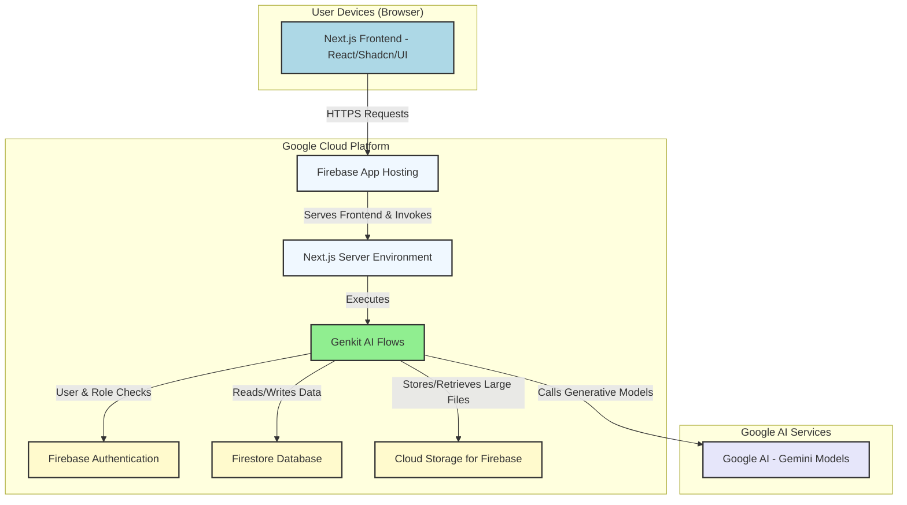
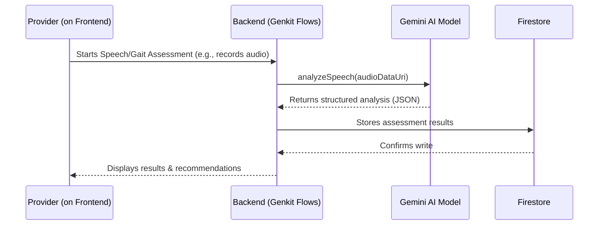

# AI-MIND Architecture Blueprint

## 1. Project Overview

### 1.1. Mission
AI-MIND is a multi-modal dementia detection platform designed to empower healthcare professionals with cutting-edge AI tools for early, accurate, and accessible risk assessment. Our mission is to facilitate timely interventions and improve patient outcomes by identifying cognitive decline at its earliest stages through the integrated analysis of clinical data, speech patterns, and gait biometrics.

### 1.2. Target Users
-   **Healthcare Providers**: Clinicians, neurologists, and geriatricians who need efficient and objective tools to supplement traditional diagnostic methods.
-   **Patients**: Individuals undergoing assessment, providing data through intuitive, guided interfaces.
-   **Administrators**: System overseers responsible for user management, system monitoring, and ensuring data compliance.

### 1.3. Potential Impact
With a growing elderly population, the need for scalable and affordable dementia screening tools is critical. AI-MIND aims to democratize access to advanced diagnostics, reduce the burden on specialized healthcare services, and enable proactive care planning, ultimately improving the quality of life for at-risk individuals.

---

## 2. System Architecture Diagram

The AI-MIND platform is built on a modern, serverless architecture that tightly integrates a Next.js frontend with Google's Genkit AI framework and Firebase for backend services. This design ensures scalability, security, and a seamless developer experience.



---

## 3. Technology Blueprint

Our technology choices prioritize developer productivity, scalability, and the rapid integration of generative AI features.

| Layer          | Technology                                   | Rationale                                                                                                    |
| -------------- | -------------------------------------------- | ------------------------------------------------------------------------------------------------------------ |
| **Frontend**     | Next.js 15 (App Router), React, TypeScript     | Enables server-first development, component-based UI, and type safety, leading to a performant and maintainable codebase. |
| **UI/Styling**   | Shadcn/UI, Tailwind CSS, Recharts            | Provides a set of accessible, composable UI components and a utility-first CSS framework for rapid, consistent styling. |
| **Backend/AI**   | Genkit (on Next.js)                          | A modern, TypeScript-native AI framework for defining, running, and monitoring serverless AI flows. Tightly integrated with Next.js. |
| **Database**     | Firebase Firestore (NoSQL)                   | A scalable, real-time NoSQL database with robust security rules, perfect for managing patient and user data.     |
| **Authentication** | Firebase Authentication                        | Provides a secure, easy-to-use authentication system with built-in support for various providers and role-based access control (RBAC). |
| **Hosting**      | Firebase App Hosting                         | A fully managed, serverless hosting service optimized for Next.js applications, offering automatic scaling and CI/CD. |
| **AI Models**    | Google AI - Gemini Family (Flash, Pro)         | State-of-the-art models for multi-modal analysis (text, audio, video) and structured data generation.         |

---

## 4. Data Flow and Integration

### 4.1. Patient Assessment Data Flow
The core user journey involves a healthcare provider guiding a patient through a multi-modal assessment.



### 4.2. API & Flow Contracts
Backend logic is exposed via Genkit "flows," which are strongly-typed TypeScript functions that act as secure server-side endpoints. Input and output schemas are defined with Zod.

**Example: `analyzeSpeechForDementiaIndicators` Flow**
-   **Input**: `{ audioDataUri: string }`
-   **Output**:
    ```json
    {
      "linguistic_features": {
        "wordFindingDifficulty": "boolean",
        "repetition": "boolean"
      },
      "acoustic_features": {
        "speechRate": "number",
        "hesitationRatio": "number"
      },
      "risk_probability": "number"
    }
    ```

---

## 5. Scalability and Performance

-   **Horizontal Scaling**:
    -   **Firebase App Hosting**: Automatically scales the number of server instances based on traffic, ensuring the application remains responsive under load.
    -   **Firestore**: Designed for massive scale with automatic sharding of data. Performance scales with the size of the result set, not the dataset.
-   **Performance Optimizations**:
    -   **Next.js App Router**: Leverages React Server Components to minimize the amount of JavaScript sent to the client, leading to faster initial page loads.
    -   **Image Optimization**: Uses the built-in `next/image` component for automatic image optimization and modern format delivery.
    -   **AI Model Selection**: Utilizes the `Gemini 2.5 Flash` model, which is optimized for speed and cost, making it ideal for interactive, real-time use cases.

---

## 6. Deployment Blueprint

-   **Continuous Integration/Continuous Deployment (CI/CD)**: The project is configured for seamless deployment with Firebase App Hosting.
    1.  **Development**: Developers push code to a feature branch on GitHub.
    2.  **Pull Request**: A PR triggers automated checks (linting, type-checking).
    3.  **Merge to Main**: Merging the PR into the `main` branch automatically triggers a new build and deployment to the production environment via Firebase App Hosting's GitHub integration.
-   **Environment Configuration**: Sensitive information like the `GEMINI_API_KEY` is managed through environment variables, configured securely within the Firebase App Hosting dashboard.

---

## 7. Risks and Limitations

-   **Data Privacy**: As a healthcare application, adherence to data privacy regulations (like HIPAA) is paramount. The current implementation relies on Firestore Security Rules for access control, but a production system would require further auditing and compliance checks.
-   **Model Accuracy**: The accuracy of AI models can vary across different demographics and languages. The models used are pre-trained and have not been fine-tuned on a specific clinical dataset, which is a key limitation for clinical use.
-   **Device Dependency**: Gait and speech analysis quality can be affected by the quality of the recording device (microphone, camera).

---

## 8. Future Roadmap

-   **Native Mobile Application**: Develop a native iOS/Android application to provide a more controlled environment for sensor data collection (gait, speech), improving the quality of AI analysis.
-   **EHR Integration**: Build integrations with common Electronic Health Record (EHR) systems to streamline the import of patient history and the export of assessment results.
-   **Advanced XAI (Explainable AI)**: Enhance the results dashboard with more advanced visualizations that provide deeper insights into the AI's decision-making process.
-   **Model Fine-Tuning**: Collaborate with clinical partners to collect a labeled dataset and fine-tune the Gemini models to improve their accuracy and reliability for dementia detection.
