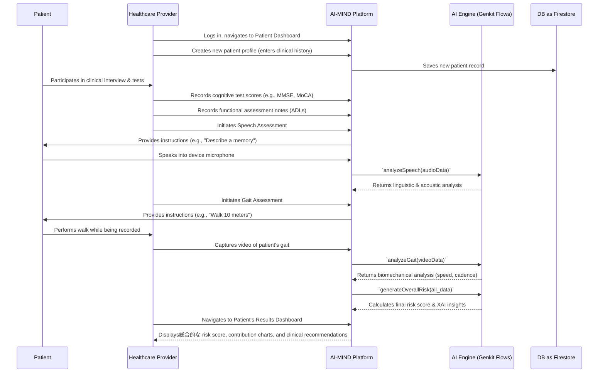

# AI-MIND: Clinical Screening and Application Workflow

## 1. Overview

This document outlines the end-to-end workflow for using the AI-MIND platform in a clinical setting. It details the journey from initial patient presentation to the delivery of a comprehensive, AI-driven dementia risk assessment. The process is designed to seamlessly integrate with and augment standard clinical practices, providing healthcare professionals with a powerful, data-driven tool for early detection.

The core philosophy is a **two-pronged approach**:
1.  **Traditional Clinical Assessment**: Leveraging the invaluable expertise and observational skills of the healthcare provider.
2.  **AI-Powered Analysis**: Using the AI-MIND platform to capture and analyze complex biomarkers in speech and gait that are difficult to quantify manually.

---

## 2. The Patient Screening Journey

The following diagram illustrates the complete workflow, showing the interaction between the patient, the healthcare provider, and the AI-MIND platform.

---

## 3. Step-by-Step Clinical and App Protocol

### Step 1: Patient Onboarding and Clinical History

1.  **Provider Action**: The healthcare provider logs into the AI-MIND platform and navigates to the Patient Dashboard.
2.  **App Action**: The provider clicks "Add New Patient" to open the multi-step patient registration form (`src/app/patients/new/page.tsx`).
3.  **Data Entry**: The provider enters all available clinical data into the form:
    *   **Demographics**: Name, age, gender, education level.
    *   **Clinical History**: Chief complaint, patient's medical history (e.g., hypertension, diabetes), relevant family history (dementia, neurological disorders), and current medications.
    *   **Functional Assessment**: Notes on the patient's ability to perform Activities of Daily Living (ADLs).
    *   **Physical Exam**: Key findings from a physical and neurological exam.
    *   **Diagnostics**: Summaries from any existing reports, such as `Cognitive Test Results` (MMSE, MoCA scores) and `MRI Scan Summary`.
4.  **App Action**: Upon submission, the data is saved (mocked in the current version) and a comprehensive patient profile is created (`src/app/patients/[id]/page.tsx`).

### Step 2: Multi-Modal AI Assessments

With the patient's baseline data entered, the provider proceeds to the AI-powered assessments.

#### A. Speech Assessment

1.  **Provider Action**: From the patient's detail page, the provider navigates to the **Speech Assessment** (`src/app/assessment/speech/[id]/page.tsx`).
2.  **App Interaction**:
    *   The provider instructs the patient on the task (e.g., "Please describe a happy recent memory" or "Describe this picture in detail").
    *   The provider uses the `AudioRecorder` component (`src/components/audio-recorder.tsx`) to start the recording. The component uses the browser's **Web Audio API** to capture high-quality audio.
    *   A real-time waveform provides visual feedback that the recording is active.
3.  **Data Processing**:
    *   Upon completion, the recorded audio is converted into a Base64-encoded data URI.
    *   This data URI is sent to the backend `analyzeSpeechForDementiaIndicators` Genkit flow (`src/ai/flows/analyze-speech-for-dementia-indicators.ts`).
    *   The AI model analyzes the audio for a wide range of features:
        *   **Linguistic**: Word-finding difficulty, sentence fragmentation, repetition, coherence.
        *   **Acoustic**: Speech rate, pitch variability, hesitation ratio.
4.  **App Action**: The results of the AI analysis are displayed directly on the assessment page, providing immediate feedback.

#### B. Gait Assessment

1.  **Provider Action**: The provider navigates to the **Gait Assessment** page (`src/app/assessment/gait/[id]/page.tsx`).
2.  **App Interaction**:
    *   The provider instructs the patient to perform a standardized walking task (e.g., "Walk in a straight line for 10 meters, turn around, and walk back").
    *   Using the device's camera (accessed via `getUserMedia`), the provider records a video of the patient's gait.
3.  **Data Processing**:
    *   The captured video would be sent to the `analyzeGaitForDementiaIndicators` Genkit flow (`src/ai/flows/analyze-gait-for-dementia-indicators.ts`).
    *   The AI model analyzes the video to extract key biomechanical features:
        *   **Spatiotemporal Metrics**: Gait speed, stride length, cadence, and gait variability.
4.  **App Action**: The extracted metrics would be saved and associated with the patient's assessment record. (Note: The video submission and analysis are mocked in the current UI).

### Step 3: Risk Calculation and Synthesis

-   **Backend Action**: Once all assessments are complete, a final Genkit flow (e.g., `generateOverallRisk`) would be triggered.
-   **Ensemble Model**: This flow takes all available data points—clinical history, cognitive scores, speech analysis, and gait analysis—and feeds them into an ensemble AI model.
-   **Final Output**: The model generates a single, holistic **dementia risk score** (e.g., a percentage from 0-100%) and a classification (`Low`, `Medium`, `High`).

### Step 4: Results Visualization and Interpretation (XAI)

1.  **Provider Action**: The provider navigates to the **Results Dashboard** (`src/app/results/[id]/page.tsx`) for the patient.
2.  **App Action**: The dashboard presents the AI's findings in a clear, interpretable, and actionable format, emphasizing Explainable AI (XAI).
    *   **Overall Risk Score**: The final risk percentage and level are displayed prominently.
    *   **Risk Factor Contribution Chart**: A bar chart (`src/components/risk-factor-chart.tsx`) visually breaks down which factors (e.g., MRI Atrophy, Memory, Gait) contributed most to the risk score. This is a core XAI feature that builds trust and aids clinical judgment.
    *   **Modality Scores**: A breakdown of performance in different areas (Cognitive, Speech, Gait) is shown with progress bars.
    -   **AI Recommendations**: The `generateRecommendations` flow provides a list of suggested next steps for the provider, such as "Consider a more detailed neuropsychological evaluation" or "Follow-up MRI in 12-18 months." This helps translate the AI's findings into actionable clinical decisions.

This structured workflow ensures that the AI-MIND platform is not just a data collection tool, but a comprehensive decision-support system that empowers healthcare providers to make earlier, more informed assessments about dementia risk.
