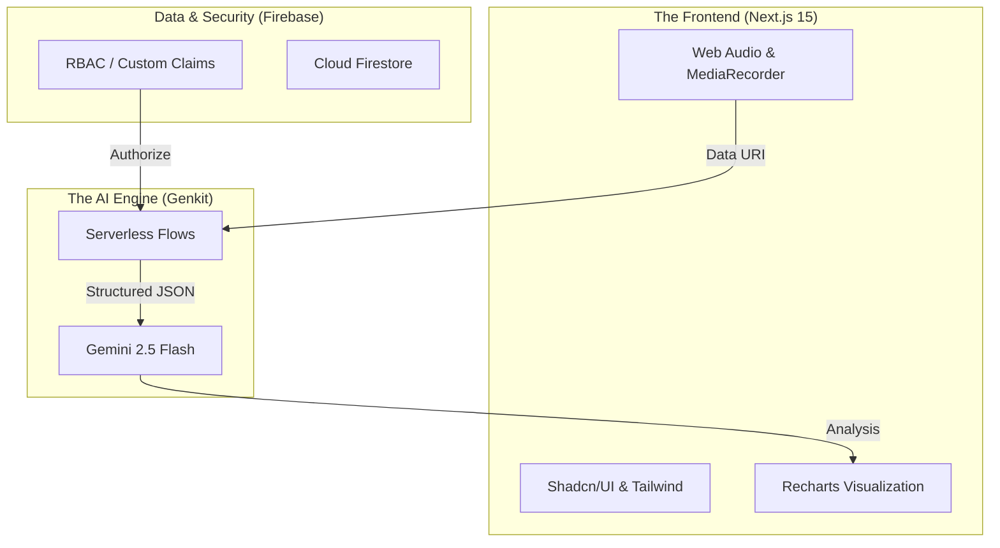

# 🧠 AI-MIND: The Clinical Co-Pilot for Early Dementia Detection

> **"Dementia is a silent thief of memories. AI-MIND is the watchman that spots it before it enters the room."**

AI-MIND is a cutting-edge, multi-modal screening platform designed for healthcare providers. It transforms the way we detect cognitive decline by turning ordinary speech and gait patterns into clinical biomarkers.

---

## 🚀 The Vision: Moving from Subjective to Objective
Traditional dementia diagnosis is often delayed, expensive, and subjective. AI-MIND solves these problems by providing:
- **Quantifiable Metrics:** Turning the "feeling" of a slow walk or a hesitant voice into hard data.
- **Explainable AI (XAI):** Not just a "Risk Score," but a rationale that shows *why* the AI is concerned.
- **Accessibility:** Screening that can happen in a GP's office with just a microphone and a camera.

---

## 🛠️ The Multi-Modal Edge

### 🎙️ Speech Analysis
Our AI listens for more than just words. It analyzes **Acoustic signatures** (pitch variability, hesitation ratios) and **Linguistic features** (word-finding difficulty, loss of coherence) to spot decline that the human ear might miss.

### 🚶 Gait Biometrics
A person's walk is a window into their brain health. AI-MIND extracts **spatiotemporal metrics**—like cadence, stride length, and gait variability—to identify the biomechanical signatures of neurodegeneration.

### 📊 Explainable Dashboard
We believe in **Trust through Transparency**. Our results page breaks down the risk into clear factors:
- **MRI Atrophy Contribution**
- **Cognitive Test Weighting**
- **Speech & Gait Indicators**

---

## 🏗️ Architecture: Serverless & Scalable

---

## 🎨 Healthcare-First Design
The interface is designed to be **visually comfortable for long clinical sessions**:
- **Palette:** Muted Purple (`#8B5CF6`) for actions, Soft Teal (`#14B8A6`) for health.
- **Typography:** Strategic hierarchy using *Inter* for maximum clarity.
- **Density:** Adaptive layouts that scale from "Comfortable" to "Compact" for data-heavy reviews.

---

## 🛣️ Roadmap: The Path Forward
- [ ] **Native Sensor Integration:** Direct access to mobile accelerometers for even finer gait analysis.
- [ ] **EHR Integration:** Seamless FHIR-based syncing with hospital systems.
- [ ] **Longitudinal Tracking:** Visualizing a patient's cognitive trajectory over years, not just days.
- [ ] **Multi-lingual Support:** Bringing early detection to non-English speaking demographics.

---

## 🏁 Quick Start
1. **Clone:** `git clone https://github.com/team-prometheus/ai-mind`
2. **Setup:** `npm install` and create a `.env` with your `GEMINI_API_KEY`.
3. **Launch:** `npm run dev` and navigate to `http://localhost:9002`.

**Team Prometheus | SIH 2025**
*Empowering clinicians, one assessment at a time.*
