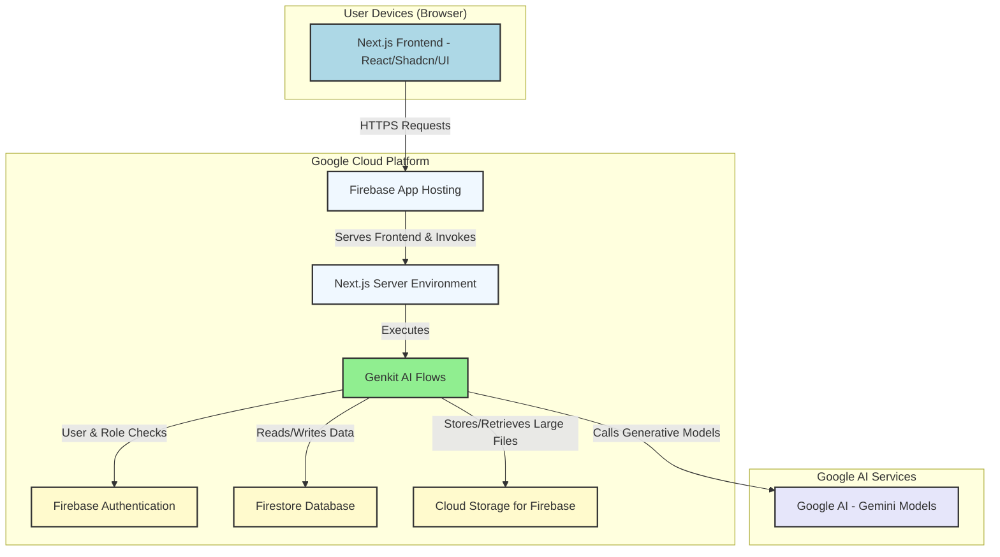
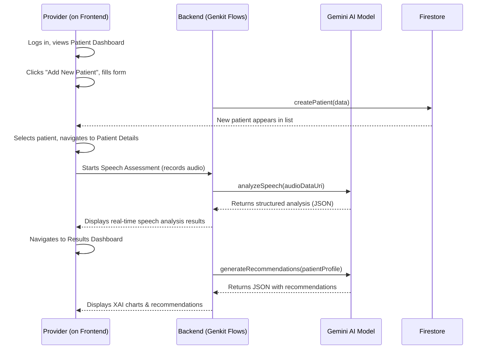

# AI-MIND: Multi-Modal AI for Early Dementia Detection [SIH 2025]


| License              | Version | Status            |
| -------------------- | ------- | ----------------- |
|  | `1.0.0` | Production Ready  |

---

## 1. Introduction and Overview

### 1.1. Problem Statement
Dementia is a growing global health crisis, with a significant impact on India's aging population. Early and accurate detection is one of the greatest challenges, often hindered by the reliance on subjective assessments, limited access to specialized neurologists, and the high cost of advanced diagnostic imaging. There is a critical need for accessible, objective, and scalable tools to identify at-risk individuals sooner, enabling timely intervention and better care planning.

### 1.2. Our Solution
**AI-MIND** is a web-based, multi-modal dementia detection platform designed to empower healthcare professionals with cutting-edge AI for early-stage risk assessment. By analyzing a combination of clinical data, speech patterns, and gait biometrics, our platform provides a holistic and objective risk score, complete with explainable AI (XAI) insights. This tool is designed to supplement, not replace, clinical judgment, providing a powerful data-driven assistant for healthcare providers in any setting.

### 1.3. Key Features
-   **Role-Based Access Control (RBAC)**: Secure, distinct interfaces for healthcare providers and system administrators.
-   **Multi-Modal AI Assessments**: Real-time analysis of speech (linguistic and acoustic features) and gait (biomechanical metrics) using device sensors.
-   **Comprehensive Patient Profiles**: A 360-degree view of patient data, including clinical history, cognitive test results, and MRI summaries.
-   **Explainable AI (XAI) Dashboard**: Interactive visualizations that break down the AI's risk assessment, fostering trust and transparency.
-   **Responsive & Accessible Design**: A modern, themeable (light/dark mode) UI built with Shadcn/UI and Tailwind CSS, ensuring a seamless experience on both desktop and mobile devices.
-   **Admin Panel**: A powerful dashboard for system monitoring, user activity tracking, and configuration.

### 1.4. Demo & Team
-   **Demo URL**: `[Link to your deployed Firebase Hosting URL]`
-   **Team**: Team Prometheus

---

## 2. Architecture Overview

AI-MIND is built on a modern, serverless architecture that tightly integrates a Next.js 15 frontend with Google's Genkit for AI orchestration and Firebase for backend services. This design ensures scalability, security, and a seamless developer experience.



> **For a complete technical deep-dive, please see the [AI-MIND Architecture Blueprint (README-blueprint.md)](README-blueprint.md).**

---

## 3. Quick Start

Get the project up and running with a single set of commands.

### Prerequisites
-   Node.js (v18.x or later)
-   npm (v9.x or later)
-   Firebase CLI (`npm install -g firebase-tools`)

### One-Command Setup
```bash
# 1. Clone the repository
git clone <your-repository-url>
cd <repository-name>

# 2. Install all dependencies
npm install

# 3. Configure your environment (see detailed setup below)
# - Create a .env file with your Firebase and Google AI keys
# - Set up a Firebase project

# 4. Run the development servers
# In terminal 1:
npm run dev

# In terminal 2 (for AI flow debugging):
npm run genkit:watch
```

---

## 4. Installation and Setup

### 4.1. Environment Setup
1.  **Create a Firebase Project**: Go to the [Firebase Console](https://console.firebase.google.com/) and create a new project.
2.  **Add a Web App**: In your project, add a new Web Application to get your Firebase configuration keys.
3.  **Enable Services**: In the Firebase Console, enable **Authentication** (with the desired providers) and **Firestore Database**.
4.  **Get Google AI API Key**: Go to [Google AI Studio](https://aistudio.google.com/) and create an API key.

### 4.2. Local Development
1.  **Clone & Install**:
    ```bash
    git clone <your-repository-url>
    cd <repository-name>
    npm install
    ```
2.  **Environment Variables**: Create a `.env` file in the project root. Copy the contents of `.env.example` (if it exists) and fill it with your keys.

    ```env
    # .env
    # Firebase Public Keys
    NEXT_PUBLIC_FIREBASE_API_KEY="AIza..."
    NEXT_PUBLIC_FIREBASE_AUTH_DOMAIN="your-project.firebaseapp.com"
    NEXT_PUBLIC_FIREBASE_PROJECT_ID="your-project-id"
    NEXT_PUBLIC_FIREBASE_STORAGE_BUCKET="your-project.appspot.com"
    NEXT_PUBLIC_FIREBASE_MESSAGING_SENDER_ID="..."
    NEXT_PUBLIC_FIREBASE_APP_ID="1:..."

    # Google AI Private Key (for server-side Genkit flows)
    GEMINI_API_KEY="AIza..."
    ```

3.  **Run Development Servers**:
    -   Next.js app (frontend & server environment): `npm run dev` (access at `http://localhost:9002`)
    -   Genkit Dev UI (for testing AI flows): `npm run genkit:watch` (access at `http://localhost:4000`)

### 4.3. Database Initialization
This project is designed to work with Firebase Firestore. While the current version uses mock data, a production setup would require security rules.
> For details on the proposed data schema and security rules, see the **Database Integration** section in the [Backend README (README-backend.md)](README-backend.md).

---

## 5. Features Breakdown

### 5.1. Provider & Patient Journey



### 5.2. Admin Journey
Admins have access to a separate, role-protected dashboard for system oversight.
-   **Analytics**: View real-time system metrics, assessment volumes, and user activity.
-   **User Management (Planned)**: A comprehensive interface to manage user roles and permissions.
-   **System Settings (Planned)**: Configure AI model parameters, security policies, and more.
-   **Audit Trail (Planned)**: A complete log of all critical user and system actions.

> For a full breakdown, see the [Admin Panel README (README-admin.md)](README-admin.md).

---

## 6. Technology Stack

| Layer          | Technology                                   | Rationale                                                                                                    |
| -------------- | -------------------------------------------- | ------------------------------------------------------------------------------------------------------------ |
| **Frontend**     | Next.js 15 (App Router), React, TypeScript     | Enables server-first development with Server Components, improving performance and developer experience.     |
| **UI/Styling**   | Shadcn/UI, Tailwind CSS, Recharts            | Provides a set of accessible, composable UI components and a utility-first CSS framework for rapid, consistent styling. |
| **Backend/AI**   | Genkit (on Next.js)                          | A modern, TypeScript-native AI framework for defining, running, and monitoring serverless AI flows. Tightly integrated with Next.js. |
| **Database**     | Firebase Firestore (NoSQL)                   | A scalable, real-time NoSQL database with robust security rules, perfect for managing patient and user data.     |
| **Authentication** | Firebase Authentication                        | Provides a secure, easy-to-use authentication system with built-in support for various providers and role-based access control (RBAC). |
| **Hosting**      | Firebase App Hosting                         | A fully managed, serverless hosting service optimized for Next.js applications, offering automatic scaling and CI/CD. |
| **AI Models**    | Google AI - Gemini Family (Flash, Pro)         | State-of-the-art models for multi-modal analysis (text, audio, video) and structured data generation.         |

> For in-depth frontend and backend documentation, see [README-frontend.md](README-frontend.md) and [README-backend.md](README-backend.md).

---

## 7. Security and Compliance

Security and privacy are foundational to the AI-MIND platform.
-   **Authentication**: Secure authentication is handled by Firebase Authentication, with role-based access control (RBAC) managed via Custom Claims.
-   **Authorization**: All sensitive pages and AI flows are protected, ensuring users can only access data they are permitted to see.
-   **Data Privacy**: The architecture is designed with HIPAA principles in mind. Firestore Security Rules are intended to enforce strict data access policies (e.g., a provider can only access their assigned patients).
-   **Audit Trail (Planned)**: A comprehensive logging system is designed to track all significant user and system actions for compliance and security monitoring.

> See the [Admin Panel README (README-admin.md)](README-admin.md) for more on security features.

---

## 8. Testing and Quality Assurance

The project is configured for robust testing to ensure code quality and reliability.
-   **Unit & Integration Tests**: **Jest** and **React Testing Library** are used for testing frontend components. Test files are co-located with their respective components.
-   **AI Flow Testing**: The **Genkit Developer UI** (`npm run genkit:watch`) provides an interactive environment for testing and debugging AI flows in isolation.
-   **Static Analysis**: **ESLint** and **TypeScript** are used for static code analysis, catching errors and enforcing code style before runtime.

```bash
# Run all unit tests in watch mode
npm test
```

---

## 9. Deployment Guide

The application is optimized for serverless deployment on **Firebase App Hosting**.

1.  **Install Firebase CLI**: `npm install -g firebase-tools`
2.  **Login**: `firebase login`
3.  **Initialize**: `firebase init hosting` (Select your Firebase project and configure it for a web framework build).
4.  **Build**: `npm run build`
5.  **Deploy**: `firebase deploy --only hosting`

**Environment Variables**: Before deploying, ensure all required environment variables (e.g., `GEMINI_API_KEY`) are configured in the Firebase App Hosting dashboard.

---

## 10. Contributing

We welcome contributions! Please follow these guidelines:
-   **Branching**: Create a new branch for each feature or bugfix (e.g., `feature/add-new-chart` or `fix/login-bug`).
-   **Pull Requests (PRs)**:
    -   Submit PRs against the `main` branch.
    -   Ensure all tests pass (`npm test`).
    -   Ensure the code is linted (`npm run lint`).
    -   Provide a clear description of the changes in your PR.
-   **Code Reviews**: All PRs require at least one approval from a maintainer before being merged.

---

## 11. License

This project is licensed under the MIT License. See the [LICENSE](LICENSE) file for details.

---

## 12. References and Further Reading
- [Next.js Documentation](https://nextjs.org/docs)
- [Genkit Documentation](https://firebase.google.com/docs/genkit)
- [Shadcn/UI](https://ui.shadcn.com/)
- [Firebase Documentation](https://firebase.google.com/docs)
